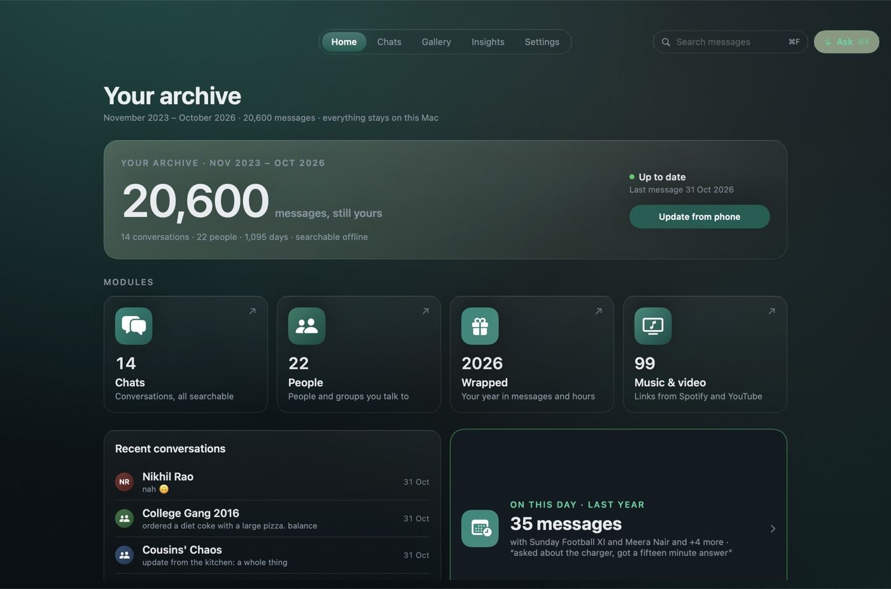
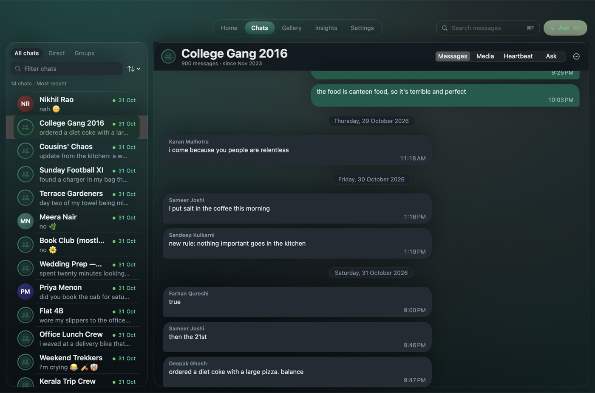
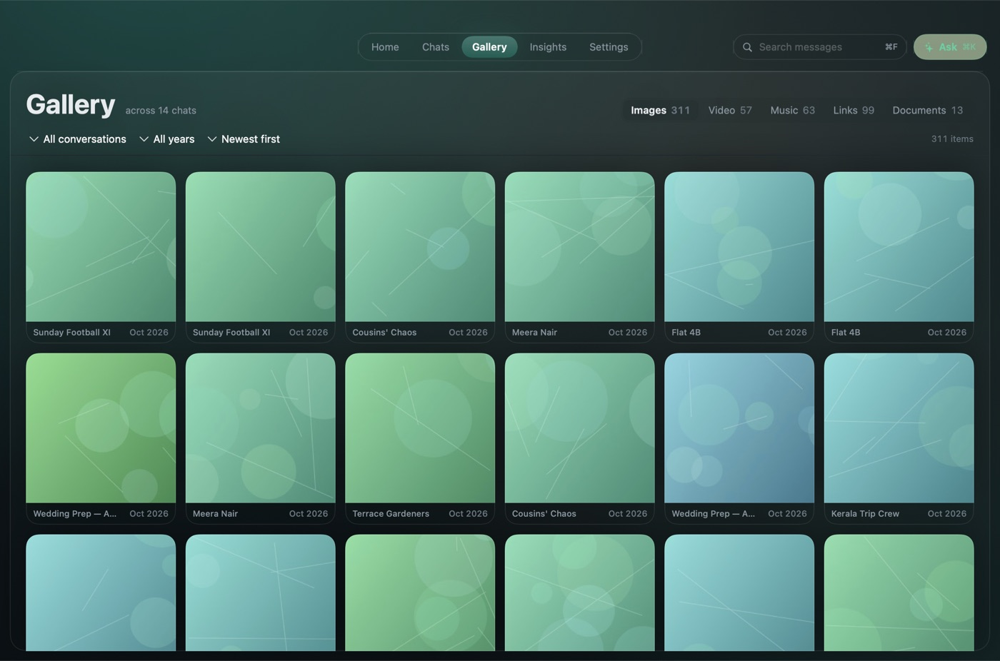
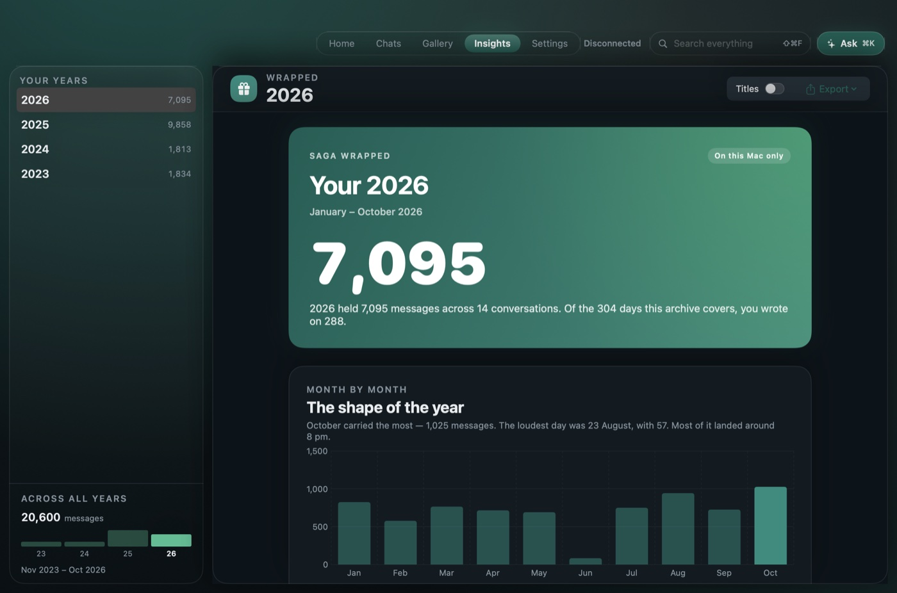
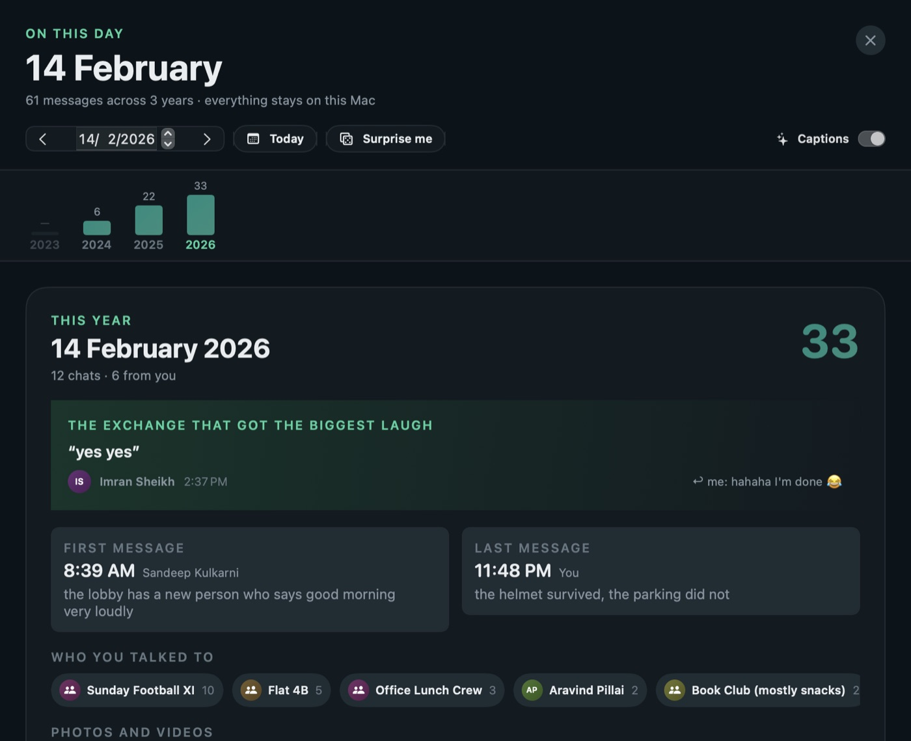

# Saga


**Every WhatsApp backup you've ever made, merged into one archive on your Mac. Nothing deleted, nothing uploaded.**

Saga reads your Android WhatsApp backups, merges old and new, and keeps messages your phone has since lost. Search all of it, offline. Needs macOS 14+ and the 64-digit backup key (not a backup password).



## Why this exists

WhatsApp gives you a phone and a backup file. Neither is an archive. The backups pile up as encrypted blobs named `msgstore-2021-04-12.db.crypt15`, and the app only ever shows you one conversation at a time.

Saga reads those files, merges them, and keeps everything. Messages you deleted from your phone six months ago are still here, marked as deleted. What you end up with is a folder of plain files you can copy to a drive and open in twenty years.

## Download

[**Saga 1.0.5 for Mac**](https://github.com/surajsunnysumanth/saga/releases/latest/download/Saga.dmg) · universal build, macOS 14 or later, 14.8 MB (14,751,604 bytes).

Open the disk image, drag Saga into Applications, and launch it. The build is ad-hoc signed, not notarised, so macOS stops the first launch with *Apple could not verify "Saga" is free of malware*. Click **Done**, open **System Settings → Privacy & Security**, scroll to **Security**, click **Open Anyway** beside Saga, then confirm with your password. The button only appears for about an hour after a blocked launch, so if it is missing, launch Saga again and go straight back to Settings. On macOS 14, right-click Saga in Finder and choose **Open** instead.

SHA-256 of `Saga.dmg`:

```
d31cdeca9a7559bc1b292f92d97de32bc83d1f6a2ac99003bdaa3c1b0deaad43
```

Check it before you drag the app anywhere: `shasum -a 256 ~/Downloads/Saga.dmg`. Every release is also on the [releases page](https://github.com/surajsunnysumanth/saga/releases).

## What it does

- **Import what you have.** Android `crypt15` backups over USB or from a file; iPhone import is experimental.
- **Merge, never replace.** Add an older backup and Saga keeps both; messages missing from the newer phone backup are flagged, not dropped.
- **Search every message**, then jump to it in context. Inside a conversation ⌘F finds within that chat and counts the matches; ⇧⌘F searches everything.
- **People, not numbers.** Names from your contacts; merge someone's old and new numbers, undo any time.
- **Voice notes have a shelf.** The Gallery's Voice notes tab lists every one with who sent it, the chat it came from, the date and length, and one player for the whole list. A note that is only in your cloud backup offers to come off the phone.
- **Media inside a chat.** A conversation's Media tab is the Gallery narrowed to it: the same tabs, cards and playback.
- **Clean up spam** per chat — media, repeats, link-only posts, or the whole group — reversibly.
- **Wrapped.** A year in review, or the story of one chat: who texts first, reply times, the songs you swapped. Reactions are counted, with hearts kept apart from laughs, stickers get their own number, and every notable moment shows what it collected — `(6 reacts)`, the emoji breakdown, and the replies that quoted it. A partial year says how many days it covers and how many of them you actually wrote on.
- **Might need your reply.** Unanswered questions in one-to-one chats, newest first, in the last six months by default — with a count of the older ones it left out.
- **Music and video from your chats.** Every Spotify, Apple Music and YouTube link shared with someone, playable in place.
- **Local AI, optional.** Summaries, topics and a single Ask button (⌘K) on Apple Intelligence or Ollama; every answer points back to the messages it used.
- **Export and MCP.** Export a conversation or a Wrapped page, or connect Claude Code through the built-in [MCP server](docs/MCP.md).
- **Knows when there's a new version.** Once a day, on launch, Saga asks GitHub for the latest release and shows a one-line "1.0.5 is available — Download" note on Home when there is one. Turn it off in Settings → Archive → Updates.

<table>
<tr>
<td></td>
<td></td>
</tr>
<tr>
<td></td>
<td></td>
</tr>
</table>

## What it doesn't do yet

- iPhone import is experimental: it reads an existing backup folder, not a live USB pull, and it isn't a verified, non-technical flow. Don't rely on it as your only copy.
- Incremental `msgstore-increment-*.crypt15` files are not parsed. Run a fresh backup in WhatsApp instead.
- WhatsApp's own Google Drive backups are encrypted by Meta and cannot be opened.
- Builds are ad-hoc signed, not notarised, so macOS asks you to approve the first launch yourself. [docs/NOTARISATION.md](docs/NOTARISATION.md) records the decision and what changes when that is no longer true.

## Privacy

- No account, no analytics, no cloud AI. Indexing, search and AI run on this Mac: Apple Intelligence through Foundation Models, or Ollama and LM Studio over loopback (`127.0.0.1`).
- Saga contacts the network only when you turn on link previews, press play on a player, let setup download Google's Android tools, or on the once-a-day update check. [PRIVACY.md](PRIVACY.md) lists every case, including the ones you start by putting your vault in a synced folder.
- The update check is one `GET` to `api.github.com` for the latest release, at most once every 24 hours. It sends no identifier, no archive data, no usage and no query string, and it keeps no state beyond the last-checked time and the version it saw. Nothing is shown when it fails. Switch it off in Settings → Archive → Updates; that sets `updateChecksEnabled` to `false` and no request is made at all.
- The 64-digit Android key lives in the macOS Keychain, if you ask Saga to remember it.
- Vault encryption is optional and off by default: a passphrase plus an independent recovery code, with a printable recovery kit. The search index and AI caches stay unencrypted, because they can be rebuilt.

## Build from source

Requires macOS 14 or newer and the Swift 6 toolchain.

```bash
swift build -c release
swift test
scripts/make_app.sh --universal
open build/Saga.app
```

To look around without touching your own data, generate the synthetic demo archive: 20,600 messages, invented people, real music links, placeholder photos.

```bash
.build/release/saga demo --out build/demo
build/Saga.app/Contents/MacOS/Saga --demo build/demo
```

`--out` must be a new folder; an existing one is never overwritten.

## First run

Pick your platform, point Saga at a backup, and it walks you through the key. For Android over USB: unlock the phone, turn on USB debugging, and approve the computer when asked. For a file: drop in the `crypt15` backup and its 64-digit key, or let Saga pull the backup from the phone.

Your original backups are never modified. Keep a copy somewhere else anyway.

A vault is a folder of plain, append-only files. [docs/ARCHITECTURE.md](docs/ARCHITECTURE.md) describes the layout.

## Troubleshooting

**Where do I find the Android key?** It is the 64-digit hexadecimal key WhatsApp uses to encrypt its backups, not the backup password and not your phone passcode. Look under WhatsApp's encrypted-backup settings; Saga cannot recover a lost key.

**ADB says unauthorized, or no device.** Use a data-capable USB cable, unlock the phone, enable USB debugging and approve the prompt. Disconnect other phones while importing.

**Names or media are missing.** Import a contacts file or allow Contacts access, then rebuild. For media, add the original folders in **Settings › Archive › Media folders**. A message database never contains every attachment, so a missing file shows a "not available" chip rather than an error.

**The backup is old, or an incremental import fails.** Make a new full backup in WhatsApp and retry.

**AI is unavailable.** The rest of Saga works without it. Enable Apple Intelligence on a supported Mac, or start Ollama or LM Studio. See [docs/AI.md](docs/AI.md).

**Answers come back thin.** Search is keyword-based; **Ask your archive** adds meaning-based retrieval once its local index is ready. If it says it fell back to keywords, the meaning index hasn't finished building. See [docs/AI.md](docs/AI.md).

## Contributing

Three products in one Swift package: `SagaCore` holds the logic, `SagaApp` is the SwiftUI shell, `saga` is the CLI. Tests run against synthetic databases, never a real archive.

Start with [CONTRIBUTING.md](CONTRIBUTING.md) and [docs/ARCHITECTURE.md](docs/ARCHITECTURE.md). Bugs and ideas: open an issue.

## Licence

MIT, see [LICENSE](LICENSE).

Saga is not affiliated with WhatsApp or Meta. Use it with your own data, and mind WhatsApp's terms when exporting.
